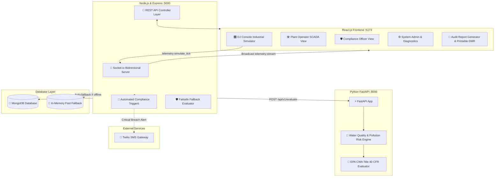

# 🌊 EcoFlow AI - Industrial Water Treatment & Environmental Compliance Platform

[](#)
[](#)
[](#)
[](#)

> **EcoFlow AI** is a production-ready, full-stack industrial water treatment SCADA and environmental compliance monitoring platform. It pairs a **Node.js/Express & Socket.io backend**, a **MongoDB database** with Mongoose schemas, a **Python FastAPI AI analytics microservice** evaluating discharge parameters against EPA regulatory limits, and a modern **React.js dashboard** featuring an interactive hardware-styled **"DJ Console" sensor simulator**.

---

## 🏗️ System Architecture



---

## ⚡ Tech Stack

| Layer | Technologies |
|---|---|
| **Frontend** | React 18, Vite, Tailwind CSS, Recharts (real-time trendlines), Lucide React, Socket.io-client |
| **Backend** | Node.js, Express.js, Socket.io (WebSocket telemetry), Mongoose, JWT, bcryptjs, Axios, Twilio SDK |
| **Database** | MongoDB (Facilities, SensorMetrics, ComplianceAlerts, AuditLogs, Users) + Resilient In-Memory Mode |
| **AI Analytics Microservice** | Python 3.10+, FastAPI, Uvicorn, Pydantic (Water Quality Index & Risk Scoring) |
| **Alert Notifications** | Twilio SMS with automated simulated fallback mode |

---

## 🚀 Quickstart Guide

### 1. Prerequisites
- **Node.js** (v18 or higher) & **npm**
- **Python** (v3.9 or higher) & **pip**
- **MongoDB** (Local or Atlas URI — *optional: server runs with automatic zero-downtime memory persistence if MongoDB is not locally running*)

---

### 2. Setup the Python AI Analytics Microservice

```bash
cd ai-service

# Create and activate virtual environment
python -m venv venv
# On Windows:
.\venv\Scripts\activate
# On Linux/macOS:
source venv/bin/activate

# Install dependencies
pip install -r requirements.txt

# Start FastAPI Microservice on port 8000
python main.py
```
*The AI microservice will start at `http://localhost:8000` (Interactive API docs at `http://localhost:8000/docs`).*

---

### 3. Setup the Node.js / Express Backend

```bash
cd backend

# Install dependencies
npm install

# Copy environment configuration
cp .env.example .env

# Start Backend Server on port 5000
npm run dev
```
*The backend server will run on `http://localhost:5000` with WebSocket stream at `ws://localhost:5000`.*

---

### 4. Setup the React Frontend

```bash
cd frontend

# Install dependencies
npm install

# Copy environment configuration
cp .env.example .env

# Start Vite development server
npm run dev
```
*Open your browser and navigate to `http://localhost:5173`.*

---

## 🎛️ Special Feature: The "DJ Console" Industrial Simulator

The interactive **DJ Console** is a hardware-inspired audio/SCADA mixing console panel that puts factory sensor simulation at the operator's fingertips:

- **Vertical Faders**:
  - **CH 01 // pH Level (0.00 – 14.00)**: Visual color zone indicating acid, safe EPA band (6.5 – 8.5), and alkaline.
  - **CH 02 // Turbidity (0.0 – 100.0 NTU)**: Optical clarity slider with threshold flag at 50 NTU.
  - **CH 03 // Chemical Dosing Rate (0 – 500 mg/L)**: Reagent feed rate with overdose warning > 200 mg/L and spike > 350 mg/L.
  - **CH 04 // Effluent Flow Rate (0 – 1000 L/s)**: Hydraulic outfall velocity slider.
- **Preset Injection Switches**:
  - 🟢 **"Normal Operations"**: (pH 7.20, Turbidity 4.5 NTU, Dosing 45 mg/L, Flow 120 L/s)
  - 🟡 **"Chemical Overdose Spike"**: (Dosing 420 mg/L, pH drops to 5.40, Turbidity 25 NTU)
  - 🔴 **"pH Critical Breach"**: (pH drops to 3.20 or spikes to 11.80, triggers emergency alarm)
  - ⚪ **"Sensor Offline"**: (Simulates probe failure / communication cut)
- **Auto-Tick Generator**:
  - Runs a 2.0-second broadcast loop sending telemetry to the backend and AI microservice.
  - Includes toggleable **Brownian noise jitter** to simulate real sensor signal physics.
- **Visual Feedback**:
  - Dynamic LED VU meter bars responding to channel intensities.
  - Master AI Risk Beacon dynamically transitioning between **Green (Compliant)**, **Amber (Warning)**, and **Red (Critical Breach)**.

---

## 👥 Role-Based Authentication & Views

The top navbar includes an instant **Role Switcher** allowing immediate testing between all 3 operational roles:

### 1. Plant Operator (`operator@ecoflow.internal` / `password123`)
- Real-time parameter gauges with color-coded safety states.
- Live Recharts line graph streaming multi-series trends with EPA reference lines.
- Active SCADA alarm list with 1-click **Acknowledge** buttons.
- Real-time **AI Root-Cause Remediation Guide** generated by the Python microservice.

### 2. Environmental Compliance Officer (`compliance@ecoflow.internal` / `password123`)
- EPA Clean Water Act Title 40 CFR Part 136 compliance envelope monitor.
- Comprehensive compliance breach ledger with Twilio SMS dispatch verification.
- **Official Resolution Sign-Off Modal**: Commit corrective remediation notes and digitally sign off on incidents.
- Direct access to the automated Audit Report Generator.

### 3. System Administrator (`admin@ecoflow.internal` / `password123`)
- Real-time microservice health diagnostics (Express, Socket.io, MongoDB, Python AI).
- Facility discharge permit calibration form (dynamically adjusts EPA threshold ceilings).
- Registered user access manager.
- Tamper-evident regulatory audit trail event stream.

---

## 📄 Automated Environmental Audit Reports

Generate official **Discharge Monitoring Reports (DMR)** formatted for environmental regulatory boards (EPA, state DEQ, ISO 14001):
- **Date Range Filters**: 24 Hours, 7 Days, or 30-Day Monthly DMR.
- **Summary Statistical Analytics**: Min, Max, and Mean calculations for pH, Turbidity, Chemical Dosing, Flow, and BOD.
- **Complete Incident Ledger**: Detailed list of all violations, measured deviations, and recorded resolutions.
- **Certified Inspector Sign-Off**: Official signature block, date stamp, and SHA-256 digital verification hash.
- **Export Formats**:
  - Click **"Print / Save PDF"** for clean `@media print` regulatory layout.
  - Click **"Export JSON"** for raw structured audit payloads.

---

## 📡 REST & WebSocket API Reference

### Real-Time WebSocket Events (`ws://localhost:5000`)
| Direction | Event Name | Payload / Description |
|---|---|---|
| Client -> Server | `telemetry:simulate_tick` | Telemetry payload from DJ Console |
| Server -> Client | `telemetry:stream` | Broadcasts processed metric, AI risk score, and triggered alerts |
| Client -> Server | `alert:acknowledge` | `{ alertId, actorName }` |
| Server -> Client | `compliance:alert_triggered` | Broadcasts new compliance breach to all dashboards |
| Server -> Client | `alert:updated` | Emits updated status when acknowledged or resolved |

### Backend REST Endpoints (`http://localhost:5000/api`)
- `POST /api/auth/login` - Authenticate and receive JWT token
- `GET /api/auth/demo-credentials` - Retrieve preconfigured accounts
- `POST /api/telemetry/ingest` - Ingest sensor telemetry via HTTP
- `GET /api/telemetry/history` - Fetch time-series historical metrics
- `GET /api/alerts` - List active & resolved compliance alerts
- `PATCH /api/alerts/:id/acknowledge` - Operator alert acknowledgment
- `PATCH /api/alerts/:id/resolve` - Compliance officer resolution with remediation notes
- `GET /api/reports/compliance` - Generate official regulatory audit report data
- `GET /api/health` - Complete system and microservice diagnostic status

### Python AI Microservice Endpoints (`http://localhost:8000`)
- `POST /api/v1/evaluate` - Evaluates single telemetry frame against EPA discharge limits
- `POST /api/v1/batch-evaluate` - Batch historical trend risk analysis
- `GET /api/v1/regulatory-standards` - EPA Title 40 CFR reference limits
- `GET /api/v1/health` - AI model health and standards metadata

---

## 🐙 Git & GitHub Commands

To initialize and publish this repository to GitHub:

```bash
# 1. Initialize git repository from the project root
git init

# 2. Stage all project files (safe .gitignore protects .env and node_modules)
git add .

# 3. Create initial commit
git commit -m "feat: initial commit for EcoFlow AI industrial water treatment platform"

# 4. Link to your GitHub repository
git remote add origin https://github.com/<your-username>/ecoflow-ai.git

# 5. Rename branch to main and push
git branch -M main
git push -u origin main
```

---

## 🔒 Security & Environment Variables

All sensitive credentials (MongoDB connection strings, JWT secrets, Twilio API tokens) are managed using `dotenv`. Never commit `.env` files to source control. Refer to `.env.example` in each service directory for configuration keys.

---

## 📜 License
Distributed under the MIT License. Built for industrial water stewardship and regulatory compliance excellence.
